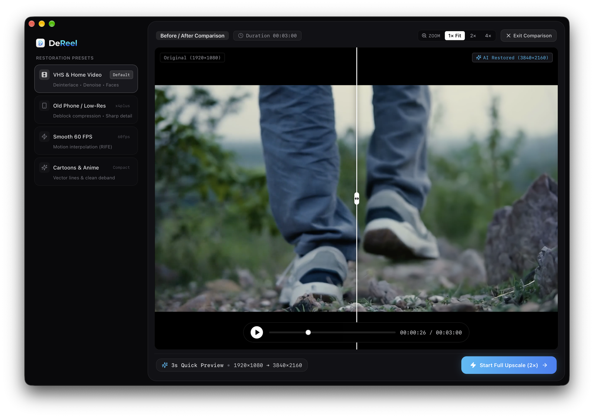
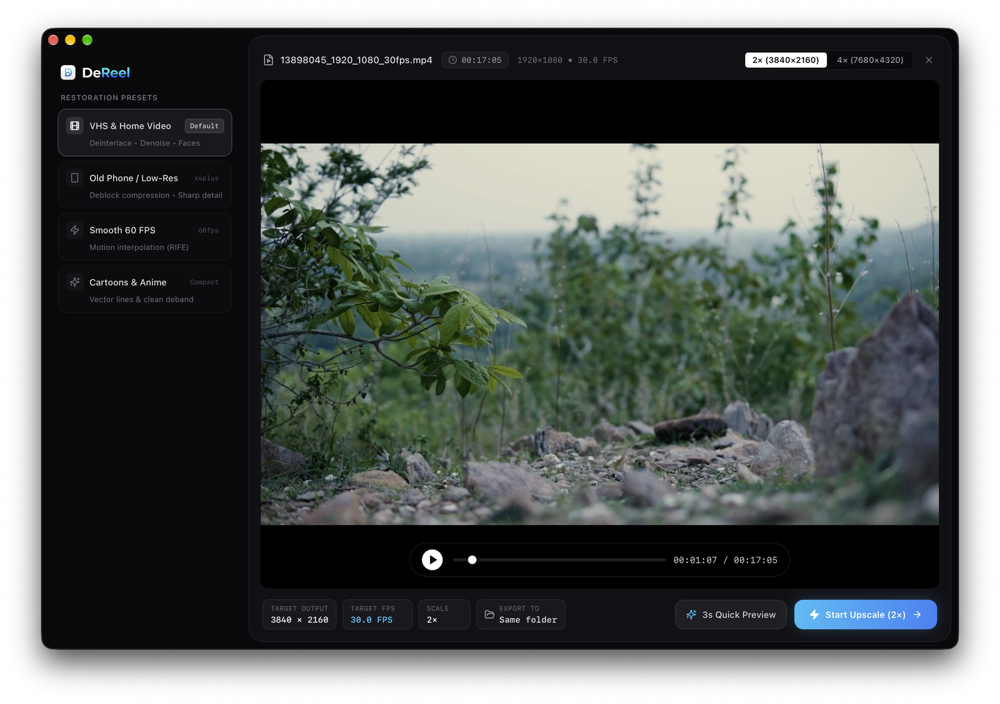
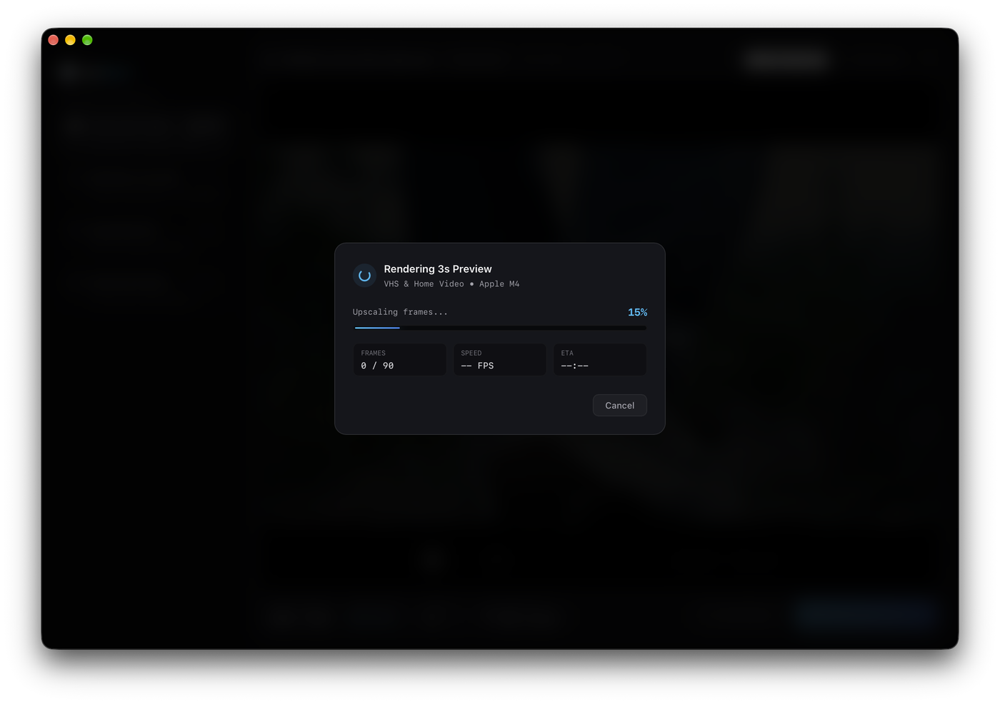
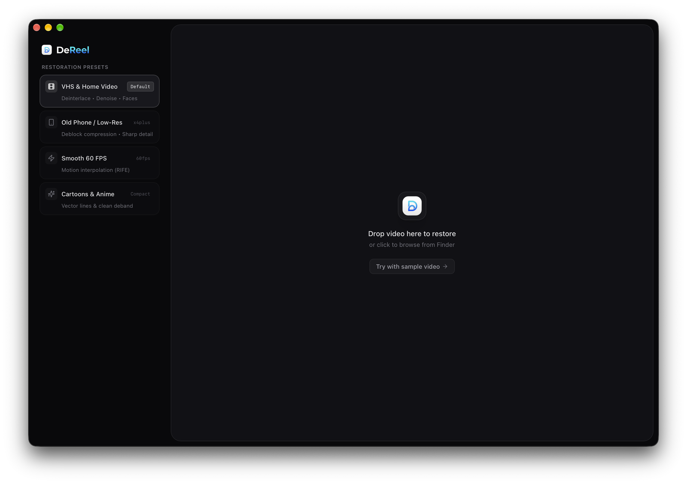
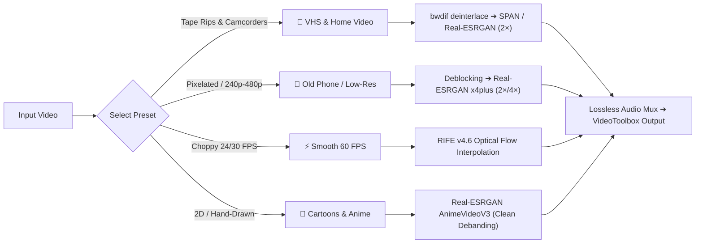

<div align="center">


# DeReel

**Local AI Video Restoration & Upscaling for macOS**  
*100% Private • Zero Cloud Reliance • Zero Temporary Disk Writes*

[-000000?style=flat&logo=apple&logoColor=white)](https://github.com/MaxPoshyvak/DeReel/releases)
[](https://tauri.app/)
[](https://www.rust-lang.org/)
[](https://react.dev/)
[](LICENSE)
[-success)](SPEC.md#1-vision)

<p align="center">
  <a href="#-quick-download">Download</a> •
  <a href="#-why-dereel">Why DeReel?</a> •
  <a href="#-key-features">Key Features</a> •
  <a href="#-presets">Restoration Presets</a> •
  <a href="#-architecture--performance">Architecture</a> •
  <a href="#-building-from-source">Build from Source</a> •
  <a href="#-privacy--license">License</a>
</p>

---

</div>

<div align="center">
  
  <p align="center"><em>Interactive Before / After comparison slider with real-time playback, 1×/2×/4× inspection zoom, and timecode sync.</em></p>
</div>

---

## ⚡ Why DeReel?

Most AI video upscalers force you into one of two extremes:
1. **Expensive Cloud Subscriptions ($30–$100/mo):** You upload your personal family memories or private footage to remote servers, wait in processing queues, and pay recurring monthly fees.
2. **Fragile Python / Conda Scripts:** Requiring terminal expertise, 15GB+ PyTorch and CUDA environments, and dumping tens of thousands of uncompressed `.png` frame files to your SSD — causing gigabytes of disk wear and potential thermal throttling.

**DeReel is the clean, native desktop alternative:**
* **2-Click Workflow:** Drag & drop your video, pick a preset, and restore. No terminal, no Python, no cloud logins.
* **100% Private & Offline:** Everything executes strictly on your local hardware using Metal / Vulkan GPU acceleration. Zero telemetry, zero analytics, zero data leaves your Mac.
* **0 MB SSD Wear:** Video frames stream strictly through in-memory pipes between FFmpeg and native neural inference engines. Never writes single-frame images to disk.
* **Instant 3-Second Interactive Preview:** Test any preset on a 3-second slice in seconds with an interactive before/after split slider before committing hours to a full export.

---

## ✨ Key Features

| Feature | Description |
| :--- | :--- |
| 🎚️ **Split-Screen Comparison** | Side-by-side interactive before/after slider with synchronous playback and **1× / 2× / 4× pan-and-zoom** inspection. |
| 🏎️ **Apple Silicon Native** | Tuned for M-series unified memory architecture (M1 through M5) with Metal GPU shaders and hardware VideoToolbox encoding. |
| 🛡️ **Zero Disk Wear Pipeline** | Frames stream via in-memory bounded RAM pipes `FFmpeg ➔ GPU ➔ FFmpeg`. |
| 🔊 **Lossless Audio Preservation** | Original multi-channel audio tracks, subtitles, and container metadata are copied losslessly (`-c:a copy`) without sync drift. |
| 📊 **Real-Time Progress HUD** | Live display of processing stages, processed frames, rendering FPS, percent completed, and dynamic ETA calculations. |
| 📁 **Smart Output Management** | Save directly alongside original footage or choose custom destination directories with atomic write guarantees (`*.partial` renaming). |

---

## 🎬 Screenshots & Interface

<div align="center">
  <table>
    <tr>
      <td width="50%">
        
        <p align="center"><b>Workspace & Timeline Scrubber</b><br/><em>Seamless file drop, metadata inspection, and instant preset selection island.</em></p>
      </td>
      <td width="50%">
        
        <p align="center"><b>Live AI Processing HUD</b><br/><em>Non-blocking progress tracking with stage reporting, live FPS, and frame ETA.</em></p>
      </td>
    </tr>
    <tr>
      <td colspan="2" align="center">
        
        <p align="center"><b>Minimalist Drop Island</b><br/><em>Zero clutter. Drag any video file or click "Try with sample video" for an instant test run.</em></p>
      </td>
    </tr>
  </table>
</div>

---

## 📼 Restoration Presets

DeReel provides 4 carefully engineered, one-click restoration presets designed for specific video defects:



### 1. 📼 VHS & Home Video *(Default)*
* **Best for:** Analog magnetic tapes, VHS, Hi8, Betacam, interlaced camcorder captures.
* **Pipeline:** Adaptive temporal deinterlacing (`bwdif send_frame`) ➔ temporal denoiser ➔ compact super-resolution (2×) ➔ face artifact mitigation.
* **Output:** Clean progressive frames with tape-jitter suppression and natural skin textures.

### 2. 📱 Old Phone / Low-Res
* **Best for:** 2000s mobile phone clips (3GP, MP4), early digital cameras, low-bitrate web videos (240p, 360p, 480p).
* **Pipeline:** Block artifact suppression filter ➔ deep spatial reconstruction (2× or 4×).
* **Output:** Sharp edges, recovered textures, and removal of ugly MPEG compression squares.

### 3. ⚡ Smooth 60 FPS
* **Best for:** Low frame-rate animations, sports footage, drone videos, or 24/30 FPS footage needing fluid motion.
* **Pipeline:** Neural optical flow motion interpolation powered by **RIFE v4.6** (Real-Time Intermediate Flow Estimation).
* **Output:** Butter-smooth 60 FPS (or 2× source rate) without ghosting or unnatural warping.

### 4. 🎨 Cartoons & Anime
* **Best for:** Classic hand-drawn animation, retro anime, digital cartoons with ringing or gradient banding.
* **Pipeline:** Specialized **AnimeVideoV3** model with aggressive line art enhancement and gradient debanding.
* **Output:** Razor-sharp vector outlines and pure, clean color fills.

---

## 🔬 Architecture & Performance

DeReel is architected around strict engineering invariants to ensure safety, speed, and hardware longevity:

```
┌─────────────────────────────────────────────────────────────────────────────┐
│                             DE REEL CORE PIPELINE                           │
│                                                                             │
│   ┌──────────────┐     In-Memory Pipe     ┌─────────────────────────────┐   │
│   │ FFmpeg Demux │ ─────────────────────> │ Neural Inference Engine     │   │
│   │   & Decode   │    (Zero SSD writes)   │ (ncnn-vulkan / Metal / ANE) │   │
│   └──────────────┘                        └─────────────────────────────┘   │
│                                                          │                  │
│                                                   In-Memory Pipe            │
│                                                          │                  │
│                                                          ▼                  │
│   ┌────────────────────────┐   Atomic Rename   ┌────────────────────────┐   │
│   │  Final Output File     │ <──────────────── │  Hardware Encode       │   │
│   │  (e.g. video_vhs.mp4)  │   (upon success)  │  (Apple VideoToolbox)  │   │
│   └────────────────────────┘                   └────────────────────────┘   │
└─────────────────────────────────────────────────────────────────────────────┘
```

### Pipeline Invariants:
1. **Zero Temporary Frame Files on Disk:** Frames move strictly through memory pipes (`stdin`/`stdout`). Your SSD is protected from hundreds of gigabytes of temporary image wear.
2. **Bounded Backpressure:** Internal ring buffers prevent decode from outrunning inference, keeping memory usage constant and lean regardless of video duration.
3. **Atomic File Guarantees:** Output is written to a hidden `*.partial` file and atomically renamed only upon 100% successful render completion. Interrupted exports never corrupt your library.
4. **Isolated Inference Processes:** Native GPU model execution runs isolated from the UI process, ensuring that even in the event of an OS-level GPU driver reset, the UI survives and offers retry.

---

## 💻 Tech Stack

* **Desktop Host:** [Tauri v2](https://tauri.app/) (Rust 1.80+)
* **User Interface:** React 19, TypeScript (Strict Mode), Vite 6, Tailwind CSS
* **Icons & Components:** Lucide Icons, Framer Motion
* **Media Backend:** FFmpeg / FFprobe (LGPL compliant builds)
* **Inference Runtimes:** [ncnn](https://github.com/Tencent/ncnn) (Vulkan/MoltenVK) • CoreML / Apple Neural Engine (ANE)
* **Neural Models:** Real-ESRGAN (SPAN, x4plus, AnimeVideoV3), RIFE v4.6

---

## 📦 System Requirements

* **Operating System:** macOS 11.0 (Big Sur) or higher
* **Architecture:** 
  * Apple Silicon (M1 / M2 / M3 / M4 / M5 Pro, Max, Ultra) — *Recommended*
  * Intel Macs with Metal-compatible GPU (AMD Radeon or Intel Iris)
* **Memory:** 8 GB RAM minimum (16 GB+ recommended for 4K exports)
* **Disk Space:** ~80 MB for the application

---

## 🛠️ Building from Source

If you want to contribute, customize models, or build DeReel yourself:

### 1. Prerequisites

Make sure you have installed:
* [Node.js](https://nodejs.org/) (v18+) or [Bun](https://bun.sh/)
* [Rust & Cargo](https://www.rust-lang.org/tools/install) (v1.80+)
* [FFmpeg](https://ffmpeg.org/) (available on system PATH or via Homebrew):
  ```bash
  brew install ffmpeg
  ```

### 2. Clone & Install

```bash
# Clone the repository
git clone https://github.com/MaxPoshyvak/DeReel.git
cd DeReel

# Install frontend dependencies
npm install
```

### 3. Run in Development Mode

```bash
# Launch Tauri desktop application with hot-reloading
npm run tauri dev
```

### 4. Running Quality Gates

Before submitting any code changes, ensure all tests and quality checks pass:

```bash
# Rust formatting, lints, and unit tests
cargo fmt --manifest-path src-tauri/Cargo.toml -- --check
cargo clippy --manifest-path src-tauri/Cargo.toml --all-targets -- -D warnings
cargo test --manifest-path src-tauri/Cargo.toml

# Frontend build & typecheck
npm run build
```

### 5. Packaging Release Bundle

```bash
# Create native macOS .dmg bundle
npm run tauri build
```
The compiled bundle will be output to `src-tauri/target/release/bundle/dmg/`.

---

## 🔒 Privacy & Security

* **100% Offline by Default:** DeReel performs zero network calls during video processing.
* **No Phone-Home or Telemetry:** We do not track, log, or profile your usage, video names, or hardware IDs.
* **Sandboxed Permissions:** Built on Tauri v2's capability-based security model. Only user-selected files and directories are accessible.

---

## 📄 License & Third-Party Notice

* DeReel software and UI are released under the [MIT License](LICENSE).
* Embedded inference engines and models strictly adhere to commercially permissive licenses (MIT, Apache 2.0, BSD-3-Clause).
* FFmpeg components comply with LGPL v3.
* Detailed license audits and model provenance are documented in [`docs/licenses/`](docs/licenses/).

---

<div align="center">

Crafted with care by [Max Poshyvak](https://github.com/MaxPoshyvak) • Contributions, issues, and feature ideas are warmly welcome!

<a href="https://github.com/MaxPoshyvak/DeReel/stargazers">⭐ Star us on GitHub</a>

</div>
